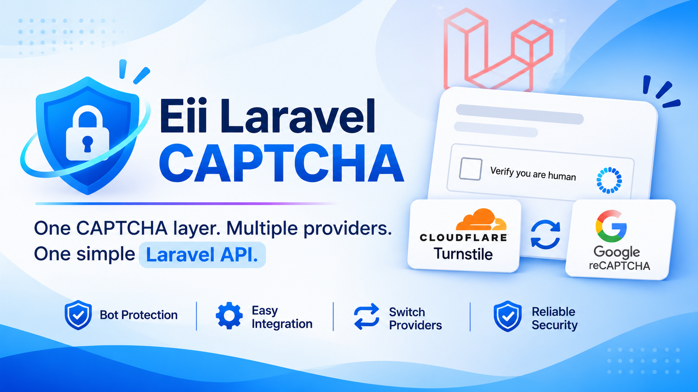

# 🛡️ Eii Laravel CAPTCHA

### One CAPTCHA layer. Multiple providers. One simple Laravel API.

<p align="center">
  
</p>

<p align="center">
  <strong>Protect your Laravel applications from automated bots and unwanted submissions.</strong>
</p>

<p align="center">
  <a href="https://packagist.org/packages/eii/laravel-captcha"></a>
  <a href="https://packagist.org/packages/eii/laravel-captcha"></a>
  <a href="https://packagist.org/packages/eii/laravel-captcha"></a>
  
  
  
</p>

---

## 🚀 Protect your application, your way.

Contact forms. Registration pages. Login screens. Public APIs.

Every publicly accessible endpoint can become a target for automated bots, spam submissions and unwanted traffic.

CAPTCHA verification helps add another layer of protection.

But integrating different CAPTCHA providers often means writing different verification logic, managing separate credentials and maintaining provider-specific implementations.

**Eii Laravel CAPTCHA brings everything together under one configurable Laravel integration.**

Currently supporting:

- ☁️ **Cloudflare Turnstile** – Privacy-friendly bot protection without traditional image puzzles.
- 🔵 **Google reCAPTCHA** – Support for reCAPTCHA v2 and v3.

Choose your provider through configuration and use the same Laravel validation and verification interfaces throughout your application.

---

## ✨ Why use Eii Laravel CAPTCHA?

Instead of tying your application directly to a particular CAPTCHA provider, this package introduces a consistent integration layer.

### Key features

| Feature | Description |
|---|---|
| 🔄 Multiple Providers | Cloudflare Turnstile and Google reCAPTCHA. |
| ⚙️ Configurable Provider | Select your preferred provider through `.env`. |
| 🧩 Blade Component | Easily embed CAPTCHA widgets into Blade forms. |
| ⚡ Livewire Integration | Includes an optional Livewire widget component. |
| ✅ Laravel Validation | Validate CAPTCHA tokens using a dedicated validation rule. |
| 🔧 Facade API | Perform manual verification using a simple API. |
| 🌐 Hostname Verification | Optional hostname allowlisting for additional protection. |
| 📊 reCAPTCHA v3 Scores | Configure a score threshold for reCAPTCHA v3. |
| 📝 Audit Logging | Optional successful verification logging. |
| 🛡️ Fail-closed Security | Verification failures and provider outages do not silently bypass protection. |
| 🩺 Diagnostic Command | Check common local configuration issues using Artisan. |

---

## 📦 Installation

Install the package through Composer:

```bash
composer require eii/laravel-captcha
```

Publish the configuration file:

```bash
php artisan vendor:publish --tag=eii-captcha-config
```

That's it! You can now configure your CAPTCHA provider.

### Requirements

| Dependency | Version |
|---|---|
| PHP | 8.2+ |
| Laravel | 11.x, 12.x, 13.x |
| Livewire | Optional |

Livewire is not required for the core package.

---

## ⚙️ Configuration

Add the following settings to your `.env` file.

### Cloudflare Turnstile

```env
EII_CAPTCHA_ENABLED=true
EII_CAPTCHA_PROVIDER=turnstile

TURNSTILE_SITE_KEY=your-site-key
TURNSTILE_SECRET_KEY=your-secret-key
```

Obtain your credentials from the [Cloudflare Turnstile Dashboard](https://dash.cloudflare.com/?to=/:account/turnstile).

### Google reCAPTCHA

Alternatively, configure Google reCAPTCHA:

```env
EII_CAPTCHA_ENABLED=true
EII_CAPTCHA_PROVIDER=recaptcha

RECAPTCHA_VERSION=v2
RECAPTCHA_SITE_KEY=your-site-key
RECAPTCHA_SECRET_KEY=your-secret-key

RECAPTCHA_SCORE_THRESHOLD=0.5
```

The package supports reCAPTCHA v2 and v3 configuration.

Obtain your credentials from the [Google reCAPTCHA Admin Console](https://www.google.com/recaptcha/admin/).

### Switch providers whenever you need

The provider is selected through:

```env
EII_CAPTCHA_PROVIDER=turnstile
```

Or:

```env
EII_CAPTCHA_PROVIDER=recaptcha
```

Your application can use the same CAPTCHA validation rule and facade regardless of the selected provider.

---

## 🧩 1. Blade Integration

Adding CAPTCHA protection to a regular Laravel form is straightforward.

Add the CAPTCHA component to your Blade template:

```blade
<form method="POST" action="{{ route('contact.store') }}">
    @csrf

    <input
        name="email"
        type="email"
        required
    >

    <x-eii-captcha name="captcha" />

    <button type="submit">
        Send Message
    </button>
</form>
```

Make sure your layout includes the scripts stack:

```blade
@stack('scripts')
```

### Validate the submission

In your controller:

```php
use Eii\Captcha\Rules\CaptchaRule;
use Illuminate\Http\Request;

public function store(Request $request)
{
    $request->validate([
        'email' => ['required', 'email'],
        'captcha' => ['required', new CaptchaRule()],
    ]);

    // Continue processing only after validation succeeds.
}
```

The CAPTCHA token is validated on the server before your application continues processing the request.

No need to write separate validation logic for every provider.

---

## ⚡ 2. Livewire Integration

Already using Livewire?

The package includes a Livewire component named:

```blade
<livewire:eii-captcha-widget field="captcha" />
```

Example:

```blade
<form wire:submit="save">

    <input
        type="email"
        wire:model="email"
    >

    <livewire:eii-captcha-widget field="captcha" />

    <button type="submit">
        Send
    </button>

</form>
```

You can then validate the submitted token using the package's `CaptchaRule` or `CaptchaManager` on the server.

**Important:** Never trust a client-side success event alone. Always perform server-side verification before processing protected actions.

Livewire integration is currently an initial scaffold. Browser-level testing and component lifecycle hardening are still needed before production use.

---

## 🎯 3. Manual CAPTCHA Verification

Sometimes you don't need a Blade component or a validation rule.

Perhaps you are building a custom form, controller or application workflow.

You can verify a CAPTCHA token directly through the package facade.

```php
use Eii\Captcha\Facades\Captcha;

if (! Captcha::verify(
    $request->input('captcha'),
    $request->ip()
)) {
    abort(422, 'CAPTCHA verification failed.');
}
```

The same API works regardless of whether you have configured Cloudflare Turnstile or Google reCAPTCHA.

This keeps provider-specific verification details out of your application code.

---

## 🛡️ 4. Additional Security Configuration

CAPTCHA verification should not depend solely on what happens in the browser.

Eii Laravel CAPTCHA includes additional security settings to help protect your application.

### Hostname verification

Enable secondary hostname verification:

```env
EII_CAPTCHA_VERIFY_HOSTNAME=true
EII_CAPTCHA_ALLOWED_HOSTNAMES=example.com,www.example.com
```

You can also configure this through the published configuration file:

```php
'verify_hostname' => true,

'allowed_hostnames' => [
    'example.com',
    'www.example.com',
],
```

This allows your Laravel application to enforce an additional hostname allowlist.

### Strict mode

```env
EII_CAPTCHA_STRICT=false
```

Use the published configuration to review the package's strict-mode behavior before enabling it.

### Verification logging

For optional success-event logging:

```env
EII_CAPTCHA_LOG_SUCCESS=false
```

Enable it when you want successful verification events recorded for audit purposes.

### Security principles

The package follows several important security principles:

- Provider secret keys remain server-side.
- CAPTCHA tokens must be verified by the server.
- Verification failures fail closed.
- Provider outages fail closed.
- Client-side success events are never sufficient proof of verification.
- Separate development and production credentials should be used.

---

## 🩺 5. Diagnostic Command

Not sure whether your CAPTCHA configuration is correct?

Run:

```bash
php artisan eii-captcha:check
```

The diagnostic command checks common local configuration errors.

It helps identify configuration problems before you start troubleshooting your application.

**Note:** The command cannot inspect credentials or hostname settings configured inside the Cloudflare or Google dashboards.

For production, configure a hostname allowlist and enable:

```env
EII_CAPTCHA_VERIFY_HOSTNAME=true
```

---

## 🧪 6. Development and Testing

You should never need to expose production credentials just to test your application.

Use provider-documented test credentials or HTTP fakes during local development and automated testing.

For example:

- Use Cloudflare's official Turnstile test keys.
- Use Google reCAPTCHA test credentials appropriate to your integration.
- Use HTTP fakes to simulate successful and failed provider responses.
- Test expired tokens and invalid verification responses.
- Test provider outages and network failures.

**Important:** Do not disable server-side verification simply because your application is running with `APP_ENV=local`.

A development environment should still exercise the same verification logic as production.

---

## 🏗️ 7. Architecture

The package is designed around a provider-independent CAPTCHA integration layer.

Conceptually, the application interacts with a common verification interface while the configured provider handles the actual CAPTCHA verification.

```text
             Laravel Application
                     |
          Blade / Livewire / API
                     |
             CAPTCHA Layer
                     |
          Provider Configuration
                /        \
               /          \
      Cloudflare          Google
       Turnstile         reCAPTCHA
               \          /
                \        /
             Server Verification
                     |
              Validation Result
```

This approach helps keep your application's business logic independent of the CAPTCHA provider.

You can change providers without rewriting every form or controller that uses CAPTCHA verification.

---

## ⚠️ Development Status

This package is currently in its **initial scaffold stage**.

The core integration structure, provider configuration, Blade component, validation rule, facade and optional Livewire integration are included.

However, the frontend widget lifecycle and Livewire integration still require additional browser-level testing and hardening.

Before production deployment, thoroughly test:

- Multiple CAPTCHA widgets on the same page.
- Livewire DOM morphing and component lifecycle.
- Expired tokens and retry behavior.
- Content Security Policy compatibility.
- External script loading.
- Provider failures and timeout handling.
- reCAPTCHA v3 score thresholds and expected actions.

The package is designed to fail closed during server verification, but this does not replace a complete security audit.

---

## 🔗 Useful Links

- **Packagist:** [eii/laravel-captcha](https://packagist.org/packages/eii/laravel-captcha)
- **GitHub Repository:** [eii-laravel-captcha](https://github.com/amit-eiitech/eii-laravel-captcha)
- **Cloudflare Turnstile:** [Official Documentation](https://developers.cloudflare.com/turnstile/)
- **Google reCAPTCHA:** [Official Documentation](https://developers.google.com/recaptcha)
- **Laravel:** [Official Documentation](https://laravel.com/docs)

---

## 🤝 Contributing

Have an idea for another CAPTCHA provider or an improvement to the existing integration?

Contributions, bug reports and feature suggestions are welcome.

You can open an issue or submit a pull request through the GitHub repository.

---

## 📄 License

This package is open-sourced software licensed under the [MIT License](LICENSE).

---

<p align="center">
  <strong>Developed with ❤️ by Eii Tech Solutions</strong>
  <br>
  <a href="https://eiitechsolutions.com">eiitechsolutions.com</a>
</p>

<p align="center">
  If you find this package useful, consider giving it a ⭐!
</p>